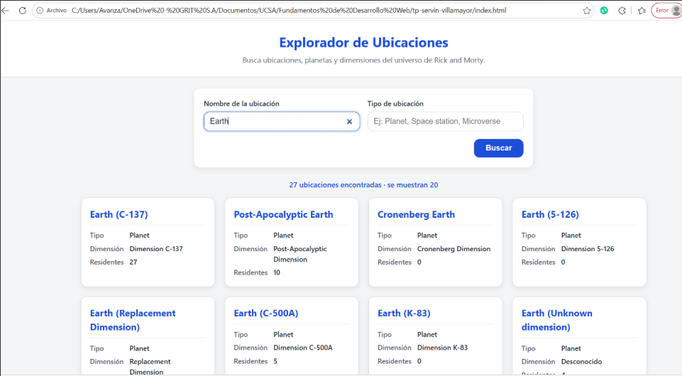

# Explorador de Ubicaciones · Rick and Morty API

Aplicación web desarrollada como Trabajo Práctico para la asignatura **Fundamentos de Desarrollo Web** (Carrera de Ingeniería en Informática).

## 📋 Información del Estudiante
- **Variante:** B · Ubicaciones (Cédula terminada en 6)
- **Asignatura:** Fundamentos de Desarrollo Web

##  Descripción del Proyecto
Esta aplicación consume la API REST pública de Rick and Morty (`https://rickandmortyapi.com/api/location`) permitiendo buscar ubicaciones filtrando por nombre y tipo de manera combinada. Cuenta con manejo de estados de carga, gestión robusta de errores HTTP y de red, renderizado seguro con DOM nativo (`createElement` y `textContent`), diseño responsivo basado en CSS Grid y Flexbox, y persistencia de la última búsqueda utilizando `localStorage`.

## 📸 Captura de Pantalla

